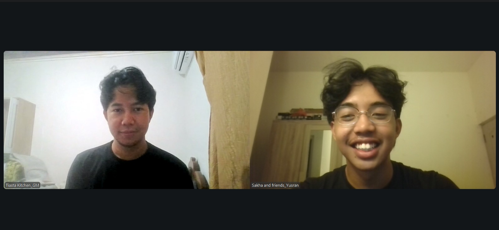
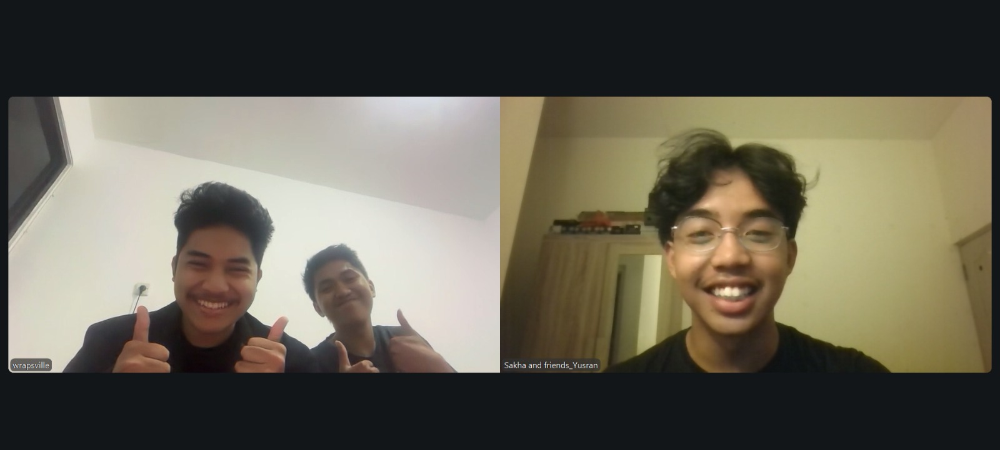
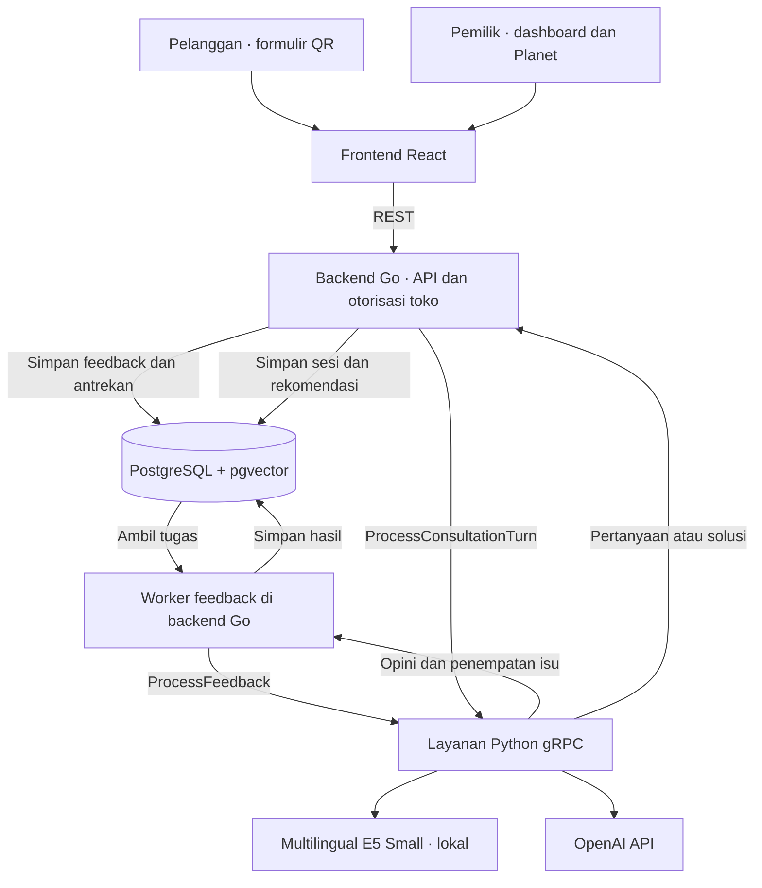

# ATLAS

**Logicodix Hackathon** · Local MSME & Creative Economy · **Web**

**CRM berbasis web untuk membantu pemilik UMKM menentukan keluhan pelanggan yang perlu ditindaklanjuti dan langkah perbaikan yang bisa dicoba.**

Pelanggan mengirim ulasan melalui QR toko. Pemilik membuka kelompok keluhan yang disebut **Planet**, membaca bukti dari pelanggan, lalu membahas satu masalah dengan AI yang menanyakan kondisi operasional tokonya.

[Lihat demo lokal](#demo-lokal) · [Lihat perbandingan produk](#perbandingan-produk) · [Daftar pustaka](#referensi)

| Tim Sakha and friends | Nama |
|---|---|
| Ketua tim | Ahmad Reza Fadlan |
| Anggota 1 | Muhammad Yusran Yuris |
| Anggota 2 | Sakha Imtinan |
| Anggota 3 | I Nengah Sutha Dharmendra |

> **Tentang repositori ini.** ATLAS menggunakan arsitektur microservices. Repositori utama mengunci versi tiga Git submodule dalam satu pengumpulan: [frontend](./frontend), [backend Go](./backend), dan [layanan AI Python](./ai-service). Gunakan `git clone --recurse-submodules` untuk mengambil ketiganya.

**Isi README**

[1. Masalah & solusi](#masalah-solusi) · [2. Inovasi teknologi](#inovasi-teknologi) · [3. Rekayasa perangkat lunak](#rekayasa) · [4. Desain & pengalaman pengguna](#desain) · [5. Etika & keamanan](#etika)

<a name="masalah-solusi"></a>

## 1. Kesesuaian Masalah & Solusi

### Apa yang dialami pemilik usaha?

| Wawancara tim | Temuan | Bagaimana ATLAS membantu |
|---|---|---|
| **Tiasta Kitchen** | Pemilik selama ini menunda penerapan CRM. Saat penjualan menurun dan beberapa pelanggan tidak kembali, pemilik menduga pengelolaan hubungan pelanggan ikut berperan. Penyebab penurunan penjualan masih perlu ditelusuri. | Pemilik dapat melihat keluhan berulang dan memeriksa pengalaman yang dilaporkan pelanggan sebelum memilih perubahan. |
| **Pandis Bakery** | Pemilik ingin memahami cara menerapkan CRM, tetapi masih bingung harus memulai dari mana. | Pemilik dapat memulai dengan satu QR dan satu masalah. Pertanyaan AI membantu menghubungkan keluhan itu dengan rutinitas toko. |
| **Wrapsville** | Masukan pelanggan masuk melalui chat WhatsApp. Pemilik kesulitan menampung seluruh masukan dalam satu tempat. | Pemilik dapat membagikan satu tautan atau QR agar masukan baru langsung tercatat per toko. Riwayat chat WhatsApp tetap berada di WhatsApp. |

| Tiasta Kitchen | Pandis Bakery | Wrapsville |
|:---:|:---:|:---:|
|  |  |  |

### Mengapa satu ulasan perlu dipecah menjadi beberapa opini?

Dalam studi kualitatif di **Locky Chicken, Pontianak**, sekitar 80% interaksi pelanggan, termasuk pesanan dan masukan, berlangsung melalui WhatsApp dan Instagram tanpa pencatatan terpadu. Peneliti memperkirakan sekitar **30% keluhan keterlambatan pengiriman** tidak tertangani secara efektif. Pengalaman satu usaha ini sejalan dengan kesulitan pencatatan yang disampaikan Wrapsville. [Hasan dkk., 2025](https://bussman.gapenas-publisher.org/index.php/home/article/view/381)

Setelah masukan terkumpul, masalah berikutnya adalah membaca isinya. Dalam **146 pasangan ulasan negatif dan balasan dari 25 restoran serta kedai kopi di Jakarta**, **73,97% ulasan memuat sedikitnya dua keluhan**. Jika satu ulasan hanya mendapat satu label, masalah kedua bisa luput dari perhatian. ATLAS menyimpan setiap opini beserta kutipannya agar satu ulasan bisa mengarahkan pemilik ke dua pemeriksaan yang berbeda. [Pitoyo & Tobing, 2026](https://journal.perbanas.id/index.php/mrsj/article/view/1363)

**Target pengguna** adalah pemilik dan pengelola UMKM lintas sektor yang menerima masukan langsung dari pelanggan. Wawancara dan studi di atas memberikan bukti awal pada sektor F&B. Pada MVP yang dapat dicoba, kategori pendaftaran yang aktif adalah **Bakery**, dan pedoman ekstraksi serta penilaian keparahan memakai konteks bakery. [Kategori aktif][kategori] · [Pedoman ekstraksi][prompt]

<a name="perbandingan-produk"></a>

### Perbandingan dengan tujuh produk

**Cara membaca matriks** · 14 November 2026

✅ Fitur terdokumentasi atau terlihat pada MVP ATLAS  
⚠️ Kemampuan terkait dengan cakupan berbeda  
❌ Fitur belum terkonfirmasi dalam dokumentasi publik yang ditelaah

| Fitur | **ATLAS** | Momos | Tattle | Ovation | StarDine | Rezup | TableOne | ResponAI |
|---|:---:|:---:|:---:|:---:|:---:|:---:|:---:|:---:|
| Pengumpulan feedback lewat QR | ✅ | ✅ | ✅ | ✅ | ✅ | ✅ | ✅ | ❌ |
| Analisis sentimen atau pemisahan pujian dan keluhan | ✅ | ✅ | ✅ | ✅ | ✅ | ✅ | ❌ | ✅ |
| Pengelompokan tema dari isi komentar | ✅ | ✅ | ✅ | ✅ | ⚠️ | ✅ | ❌ | ❌ |
| Penilaian urgensi atau keparahan keluhan | ✅ | ✅ | ⚠️ | ⚠️ | ❌ | ❌ | ⚠️ | ⚠️ |
| Saran perbaikan operasional berbasis feedback | ✅ | ✅ | ✅ | ✅ | ❌ | ❌ | ❌ | ❌ |
| Dialog lanjutan pemilik dengan AI tentang ulasan | ✅ | ✅ | ❌ | ❌ | ❌ | ❌ | ❌ | ❌ |
| AI aktif menggali konteks operasional sebelum memberi solusi per isu | ✅ | ❌ | ❌ | ❌ | ❌ | ❌ | ❌ | ❌ |

Momos memiliki irisan terluas, termasuk klasifikasi insiden dan dialog tentang ulasan. Pada ATLAS, alur dimulai dari satu Planet pilihan pemilik. AI dapat menanyakan proses yang belum diketahui, lalu menyertakan bukti pelanggan dan indikator untuk menilai tindakan yang disarankan. Pada baris urgensi, prioritas berdasarkan rating rendah, sentimen negatif, atau dampak per lokasi mendapat tanda ⚠️ karena mekanismenya berbeda dari penilaian setiap keluhan.

[Lihat dokumentasi ketujuh produk](#referensi-produk)

<a name="inovasi-teknologi"></a>

## 2. Inovasi & Implementasi Teknologi

> *“Rotinya enak, tapi kotaknya penyok dan pesanan datang terlambat.”*

**Contoh ilustratif.** Dari satu ulasan ini, pemilik perlu memeriksa kemasan dan ketepatan pengiriman secara terpisah. Rating keseluruhan tidak memberi tahu proses mana yang perlu diperbaiki.

| Aspek yang dibahas | Bukti pelanggan (`evidence_text`) | Sentimen | Hasil bagi pemilik |
|---|---|---|---|
| Rasa roti | “Rotinya enak” | Positif | Pujian tercatat dalam analisis sentimen. |
| Kondisi kemasan | “kotaknya penyok” | Negatif | Keluhan dapat masuk ke Planet kemasan. |
| Ketepatan pengiriman | “pesanan datang terlambat” | Negatif | Keluhan dapat masuk ke Planet keterlambatan. |

### Ekstraksi dan keparahan

LLM OpenAI mengurai ulasan menjadi opini, menilai sentimen positif, netral, atau negatif, serta mengembalikan kutipan asli yang menunjukkan aspek yang dibahas. Layanan memeriksa bahwa `evidence_text` benar-benar terdapat pada ulasan. Untuk MVP, `SEVERE` menandai laporan yang mengindikasikan risiko serius seperti kontaminasi makanan. Keluhan operasional seperti kemasan penyok atau pesanan terlambat masuk `NOT_SEVERE` dan tetap dapat diprioritaskan pemilik. [Implementasi ekstraksi][ekstraksi]

### Pengelompokan keluhan

Setiap opini negatif dapat bergabung dengan Planet toko yang sudah ada atau memulai Planet baru. Sistem memeriksa kecocokan judul isu, lalu menggunakan *Multilingual E5 Small* untuk mencari kandidat yang dekat secara makna. Untuk kandidat semantik, LLM memutuskan apakah masalahnya sama. Alasan desain ini terlihat dalam uji internal: pasangan “kopi susunya kemanisan” dan “kopi susunya kurang manis” memperoleh kemiripan kosinus **0,9579**, meskipun tindakan perbaikannya berlawanan. [Kode pencocokan][matching] · [Hasil uji pasangan opini][benchmark]

### Konsultasi per Planet

Pemilik membuka bukti keluhan, lalu AI mengajukan satu pertanyaan per giliran ketika konteks masih kurang. Untuk kasus kemasan, misalnya, AI bisa menanyakan kapan kotak terakhir diperiksa sebelum pesanan diserahkan. Pemilik dapat menjawab, melewati pertanyaan, atau memilih **Buat solusi sekarang**. Hasilnya memisahkan **temuan, bukti pelanggan, dugaan penyebab, rekomendasi, dan indikator keberhasilan**. Pemilik dapat melanjutkan diskusi atau menyimpan versi solusi yang dipilih. [Alur konsultasi][konsultasi]

<a name="rekayasa"></a>

## 3. Rekayasa Perangkat Lunak

### Arsitektur dan alur data



Formulir mengonfirmasi penerimaan setelah Go menyimpan masukan dan tugas pemrosesan. Worker mengambil tugas di latar belakang dan menjadwalkan percobaan ulang jika pemrosesan gagal. Saat konsultasi dimulai, Go mengambil bukti untuk isu dan toko yang dipilih. Tiap giliran memakai ID permintaan dan versi sesi agar pengiriman ulang dapat menggunakan hasil yang sudah tersimpan. Pengarsipan menyimpan solusi pilihan pemilik tanpa panggilan AI tambahan. [Kontrak REST][openapi] · [Kontrak gRPC][proto] · [Migrasi database][db]

| Komponen | Teknologi | Tanggung jawab |
|---|---|---|
| Frontend | React, TypeScript, Vite, Tailwind CSS, TanStack Query, Three.js | Formulir publik, unduhan QR/poster, dashboard sentimen, peta Planet, dan ruang konsultasi. |
| Backend | Go, Gin, GORM, PostgreSQL 17 dan pgvector | Autentikasi, akses per toko, antrean feedback, penyimpanan opini dan vektor, riwayat konsultasi. |
| Layanan AI | Python, gRPC/Protobuf, LangChain, LangSmith, Pydantic, OpenAI API, ONNX Runtime | Ekstraksi opini, embedding E5 lokal, pencocokan isu, pertanyaan klarifikasi, dan validasi struktur solusi. |

<a name="demo-lokal"></a>

### Menjalankan demo lokal

<details>
<summary><strong>Instalasi dan konfigurasi dengan PowerShell serta Docker Compose</strong></summary>

Siapkan Git, Docker Desktop dengan Linux containers dan Compose v2.24+, koneksi internet untuk build awal, serta kunci API OpenAI yang memiliki akses ke kedua model yang dikonfigurasi. Build awal mengunduh model E5 ke image Python.

**1. Ambil proyek dan siapkan konfigurasi lokal.**

```powershell
git clone --recurse-submodules https://github.com/YusranYuris/atlas-main.git
cd atlas-main
foreach ($service in 'frontend', 'backend', 'ai-service') {
    if (-not (Test-Path "$service/.env")) {
        Copy-Item "$service/.env.example" "$service/.env"
    }
}
```

Jika repo utama sudah diklon, jalankan `git submodule update --init --recursive` dari root sebelum menyalin contoh konfigurasi.

**2. Isi variabel berikut di file masing-masing.** Buat dua rahasia acak berbeda, satu untuk JWT dan satu untuk koneksi Go ke Python. Gunakan nilai token koneksi yang sama di kedua sisi.

| File | Variabel | Nilai atau fungsi untuk demo lokal |
|---|---|---|
| `frontend/.env` | `VITE_APP_NAME`, `VITE_BACKEND_URL` | `ATLAS`, `http://localhost:3333`. |
| `backend/.env` | `JWT_SECRET`, `AI_GRPC_TOKEN` | Rahasia penandatanganan JWT dan token koneksi ke Python. |
| `backend/.env` | `DOCKER_AI_GRPC_ADDR` | `atlas-ai:50051` agar worker dan konsultasi menghubungi layanan Python. Jika kosong, Compose memilih stub pengembangan. |
| `backend/.env` | `POSTGRES_USER`, `POSTGRES_PASSWORD`, `POSTGRES_DB`, `CORS_ALLOWED_ORIGINS` | Compose menggunakan kredensial database ini. Konfigurasi contoh mengizinkan frontend lokal di port 5173. |
| `ai-service/.env` | `GRPC_AUTH_TOKEN`, `OPENAI_API_KEY` | Isi dengan nilai `AI_GRPC_TOKEN` backend dan kunci OpenAI milik penyelenggara demo. |
| `ai-service/.env` | `FEEDBACK_MODEL`, `CONSULTATION_MODEL` | Gunakan ID model OpenAI yang dapat diakses akun dan mendukung keluaran terstruktur. Contoh repo masing-masing `gpt-6-luna` dan `gpt-6.1-terra`. |

Daftar lengkap variabel, termasuk batas waktu, pengaturan worker dan ukuran input, tersedia di [contoh frontend][env-fe], [contoh backend][env-go], dan [contoh layanan AI][env-ai].

**3. Jalankan ketiga komponen dari root repo.** Backend membuat jaringan Docker yang dipakai layanan Python. Migrasi database berjalan saat backend dimulai.

```powershell
docker compose --env-file backend/.env -f backend/compose.dev.yaml up -d --build db api
docker compose --env-file ai-service/.env -f ai-service/compose.yaml -f ai-service/compose.integration.yaml up -d --build
docker compose --env-file frontend/.env -f frontend/compose.dev.yaml up -d --build
```

**4. Periksa layanan.** Buka [aplikasi lokal](http://localhost:5173), [kesiapan API](http://localhost:3333/readyz), dan [Swagger UI](http://localhost:3333/docs). Periksa kesiapan Python dengan `docker inspect --format '{{.State.Health.Status}}' atlas-ai-service`. Jika AI melaporkan `UNAUTHENTICATED`, cocokkan token backend dan Python. [Panduan integrasi dan pemecahan masalah][lokal]

</details>

#### Akses juri

| URL demo | Email akun demo | Kata sandi demo |
|---|---|---|
| https://atlas-sakha-and-friends.vercel.app | john@gmail.com | johncenaa |

Pada instalasi lokal, akun pemilik dan toko dapat dibuat melalui [halaman pendaftaran](http://localhost:5173/signup).

#### Skenario demo

1. Masuk sebagai pemilik, buka **Buat QR**, lalu salin tautan formulir ke jendela privat.
2. Kirim contoh ulasan pada bagian 2.
3. Setelah worker memprosesnya, buka **Grup Feedback**, pilih Planet kemasan, dan periksa kutipan pelanggan.
4. Mulai konsultasi, jawab pertanyaan atau pilih **Buat solusi sekarang**, lalu simpan hasilnya.

**Uji melalui ponsel.** Gunakan URL frontend dan API yang dapat diakses dari ponsel serta izinkan origin frontend di CORS. Tautan `localhost` cocok untuk dua jendela browser pada komputer yang sama.

<a name="desain"></a>

## 4. Desain & Pengalaman Pengguna

| Pengguna dan tugas | Keputusan antarmuka |
|---|---|
| **Pelanggan ingin segera memberi masukan.** | QR langsung membuka formulir toko tanpa login. Pelanggan memilih bintang dan menulis pengalaman. Nama bersifat opsional. Halaman sukses memberi kepastian bahwa masukan sudah dikirim. |
| **Pemilik ingin tahu apa yang perlu diperiksa.** | Dashboard merangkum tren sentimen dan keluhan. Di peta, satu Planet mewakili satu isu. Pemilik dapat memeriksa kutipan dan membedakan jumlah opini dari jumlah ulasan unik yang menyebut isu tersebut. |
| **Pemilik ingin membahas satu masalah sampai mendapat tindakan.** | Konsultasi dibuka dari isu yang sedang diperiksa. Tombol **Lewati pertanyaan**, **Buat solusi sekarang**, dan **Simpan hasil** memberi pemilik kendali atas durasi diskusi dan hasil yang diarsipkan. |
| **Perangkat memiliki kemampuan grafis yang berbeda.** | Jika tampilan 3D tidak tersedia, isu tetap dapat dipilih melalui daftar. Tampilan Galaxy juga membaca preferensi pengurangan gerak pada perangkat. |

[Tampilan QR, dashboard, dan grup feedback][screens] · [Implementasi peta dan pilihan tampilan][galaxy]

<a name="etika"></a>

## 5. Etika & Keamanan Digital

| Hal yang dilindungi | Penerapan pada MVP |
|---|---|
| **Identitas pelanggan dan data yang dikirim ke AI** | Nama pelanggan opsional. Saat ekstraksi, Python mengirim teks ulasan, rating, dan profil toko ke OpenAI. Field nama pelanggan tidak disertakan. Data pribadi yang ditulis sendiri di dalam teks bebas tetap dapat ikut terkirim. Konsultasi menggunakan bukti dan konteks bisnis yang relevan dengan sesi. [Penyusunan input ekstraksi][input] |
| **Akun dan akses antartoko** | Backend menyimpan hash kata sandi dengan bcrypt dan merotasi refresh token. Endpoint pemilik memeriksa keanggotaan toko. Tindakan khusus pemilik juga memeriksa perannya. [Autentikasi][auth] · [Kontrol akses][akses] |
| **Bukti dan keputusan AI** | Instruksi ekstraksi memperlakukan ulasan sebagai data. Kutipan dicocokkan dengan teks asal. Dalam konsultasi, backend memeriksa struktur solusi dan ID sumber yang dirujuk. Pemilik dapat memeriksa bukti, mengoreksi konteks, dan memilih fakta usaha yang disimpan untuk sesi berikutnya. [Validasi solusi][validasi] |
| **Rahasia layanan dan log** | Kunci OpenAI berada pada layanan Python. Panggilan Go ke Python dapat diautentikasi dengan token bersama. Log operasional layanan AI mencatat ID, durasi, dan status. Konfigurasi Compose menonaktifkan pelacakan eksternal LangSmith. [Konfigurasi AI][env-ai] · [Observabilitas][logs] |

**Atribusi.** Dokumentasi wawancara berasal dari tim Sakha and friends. Rujukan studi dan produk tercantum pada bagian 1. Skenario sintetis untuk pengujian AI dan hasil eksperimen disertakan agar pembaca dapat memeriksa cara evaluasinya. Contoh ulasan dalam README adalah ilustrasi. [Bahan evaluasi][eval]

Frontend menggunakan template React–TypeScript–Vite, ikon Lucide, font Anton dan Public Sans melalui Fontsource, pustaka `qrcode` untuk QR, serta Three.js untuk Galaxy. Embedding menggunakan model pralatih **intfloat/multilingual-e5-small** dan inferensi ONNX Runtime. Layanan ekstraksi dan konsultasi memakai **OpenAI API** melalui LangChain. Dependensi pihak ketiga dan versinya tersedia pada [manifest frontend][pkg-fe], [modul Go][pkg-go], [manifest Python][pkg-ai], dan [kartu model E5](https://huggingface.co/intfloat/multilingual-e5-small).

<a name="referensi"></a>

## Daftar Pustaka & Referensi

### Riset masalah dan wawancara

1. Hasan, G., Mellysa, M., Jolie, V. A., & Ricaprio, J. (2025). *Peran Customer Relationship Management pada UMKM Locky Chicken*. [Artikel penelitian](https://doi.org/10.53363/buss.v5i2.381)
2. Pitoyo, P., & Tobing, E. B. U. (2026). *Business Response Completeness in Addressing Multiple Customer Complaints: A content analysis of restaurant and coffee shop responses in Jakarta*. Management Research Studies Journal, 7(2). [Artikel penelitian](https://doi.org/10.56174/zh2ch293)
3. Sakha and friends. *Wawancara dengan Tiasta Kitchen, Pandis Bakery, dan Wrapsville*. Sumber primer untuk pengalaman ketiga pelaku usaha. [Ringkasan wawancara](#masalah-solusi)

<a name="referensi-produk"></a>

### Dokumentasi produk pembanding

[Momos](https://webmomos.freshdesk.com/en/support/solutions/articles/150000229883-categories-v2-customizable-categories-using-ai-end-to-end) · [Tattle](https://get.tattleapp.com/features/ai-coach/) · [Ovation](https://ovationup.com/platform/insights/) · [StarDine](https://mtmsolusindo.com/stardine/) · [Rezup](https://rezup.ai/use-cases/for-restaurants) · [TableOne](https://tableone.co.id/panduan/merchant/feedback) · [ResponAI](https://www.responai.id/)

### Dokumentasi teknologi dan aset

| Komponen ATLAS | Referensi resmi |
|---|---|
| Antarmuka dan pengambilan data | [React](https://react.dev/learn) · [TypeScript](https://www.typescriptlang.org/docs/) · [Vite](https://vite.dev/guide/) · [Tailwind CSS](https://tailwindcss.com/docs/) · [TanStack Query](https://tanstack.com/query/latest) |
| Visualisasi, QR, ikon, dan tipografi | [Three.js](https://threejs.org/) · [node-qrcode](https://github.com/soldair/node-qrcode) · [Lucide](https://lucide.dev/) · [Fontsource — Anton dan Public Sans](https://fontsource.org/) |
| Backend dan penyimpanan data | [Go](https://go.dev/doc/) · [Gin](https://gin-gonic.com/en/docs/) · [GORM](https://gorm.io/docs/) · [PostgreSQL 17](https://www.postgresql.org/docs/17/) · [pgvector](https://github.com/pgvector/pgvector) |
| Pemrosesan bahasa dan konsultasi | [Python](https://docs.python.org/3/) · [LangChain](https://docs.langchain.com/) · [Pydantic](https://docs.pydantic.dev/latest/) · [OpenAI Structured Outputs](https://developers.openai.com/api/docs/guides/structured-outputs) |
| Embedding dan inferensi lokal | [Model multilingual-e5-small](https://huggingface.co/intfloat/multilingual-e5-small) · [ONNX Runtime](https://onnxruntime.ai/docs/) |
| Komunikasi layanan dan instalasi | [gRPC](https://grpc.io/docs/) · [Protocol Buffers](https://protobuf.dev/) · [Docker Compose](https://docs.docker.com/compose/) · [Git submodule](https://git-scm.com/docs/git-submodule) |

### Bukti implementasi ATLAS

- **Arsitektur dan demo.** [Kontrak REST][openapi] · [Kontrak gRPC][proto] · [Migrasi database][db] · [Panduan integrasi lokal][lokal]
- **AI dan evaluasi.** [Pedoman ekstraksi opini][prompt] · [Pencocokan isu][matching] · [Uji kemiripan E5][benchmark] · [Alur konsultasi][konsultasi] · [Skenario dan hasil evaluasi][eval]
- **Desain dan keamanan.** [Tampilan aplikasi][screens] · [Autentikasi][auth] · [Akses per toko][akses] · [Validasi sumber solusi AI][validasi]
- **Versi dependensi.** [Frontend][pkg-fe] · [Backend Go][pkg-go] · [Layanan Python][pkg-ai]

[kategori]: https://github.com/Elioth-Gray/atlas-backend-core/blob/2bf7f083e1d6dee37271382f938dc336dfdbfbbd/migrations/000005_seed_bakery_category.up.sql
[prompt]: https://github.com/ahmdrezaa/atlas-ai-service/blob/cc9cd7ef84b474775483692e5ec4c9516fe99b84/src/atlas_ai/feedback/prompts.py
[ekstraksi]: https://github.com/ahmdrezaa/atlas-ai-service/tree/cc9cd7ef84b474775483692e5ec4c9516fe99b84/src/atlas_ai/feedback
[matching]: https://github.com/ahmdrezaa/atlas-ai-service/blob/cc9cd7ef84b474775483692e5ec4c9516fe99b84/src/atlas_ai/feedback/matching.py
[benchmark]: https://github.com/ahmdrezaa/atlas-ai-service/blob/cc9cd7ef84b474775483692e5ec4c9516fe99b84/evaluation/feedback_p_a2_embedding_benchmark.json
[konsultasi]: https://github.com/ahmdrezaa/atlas-ai-service/tree/cc9cd7ef84b474775483692e5ec4c9516fe99b84/src/atlas_ai/consultation
[openapi]: https://github.com/Elioth-Gray/atlas-backend-core/blob/2bf7f083e1d6dee37271382f938dc336dfdbfbbd/api/openapi.yaml
[proto]: https://github.com/Elioth-Gray/atlas-backend-core/blob/2bf7f083e1d6dee37271382f938dc336dfdbfbbd/proto/atlas/ai/v1/ai.proto
[db]: https://github.com/Elioth-Gray/atlas-backend-core/tree/2bf7f083e1d6dee37271382f938dc336dfdbfbbd/migrations
[env-fe]: https://github.com/Elioth-Gray/atlas-frontend/blob/ac3ceedfbc402e107ed47f659081e1cde70c56c3/.env.example
[env-go]: https://github.com/Elioth-Gray/atlas-backend-core/blob/2bf7f083e1d6dee37271382f938dc336dfdbfbbd/.env.example
[env-ai]: https://github.com/ahmdrezaa/atlas-ai-service/blob/cc9cd7ef84b474775483692e5ec4c9516fe99b84/.env.example
[lokal]: https://github.com/ahmdrezaa/atlas-ai-service/blob/cc9cd7ef84b474775483692e5ec4c9516fe99b84/docs/local-testing.md
[screens]: https://github.com/Elioth-Gray/atlas-frontend/tree/ac3ceedfbc402e107ed47f659081e1cde70c56c3/public/images/screens
[galaxy]: https://github.com/Elioth-Gray/atlas-frontend/blob/ac3ceedfbc402e107ed47f659081e1cde70c56c3/src/pages/FeedbackGroup/components/FeedbackGalaxy.tsx
[input]: https://github.com/ahmdrezaa/atlas-ai-service/blob/cc9cd7ef84b474775483692e5ec4c9516fe99b84/src/atlas_ai/feedback/extractor.py
[auth]: https://github.com/Elioth-Gray/atlas-backend-core/blob/2bf7f083e1d6dee37271382f938dc336dfdbfbbd/internal/service/auth.go
[akses]: https://github.com/Elioth-Gray/atlas-backend-core/blob/2bf7f083e1d6dee37271382f938dc336dfdbfbbd/internal/service/access.go
[validasi]: https://github.com/Elioth-Gray/atlas-backend-core/blob/2bf7f083e1d6dee37271382f938dc336dfdbfbbd/internal/service/consultation_validate.go
[logs]: https://github.com/ahmdrezaa/atlas-ai-service/blob/cc9cd7ef84b474775483692e5ec4c9516fe99b84/src/atlas_ai/observability.py
[eval]: https://github.com/ahmdrezaa/atlas-ai-service/tree/cc9cd7ef84b474775483692e5ec4c9516fe99b84/evaluation
[pkg-fe]: https://github.com/Elioth-Gray/atlas-frontend/blob/ac3ceedfbc402e107ed47f659081e1cde70c56c3/package.json
[pkg-go]: https://github.com/Elioth-Gray/atlas-backend-core/blob/2bf7f083e1d6dee37271382f938dc336dfdbfbbd/go.mod
[pkg-ai]: https://github.com/ahmdrezaa/atlas-ai-service/blob/cc9cd7ef84b474775483692e5ec4c9516fe99b84/pyproject.toml
